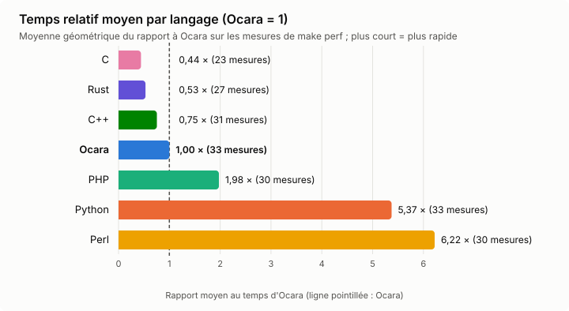
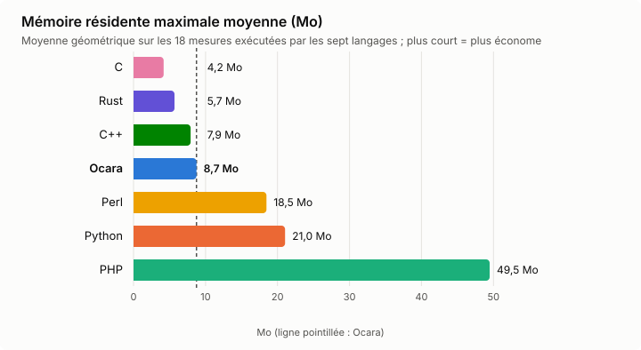
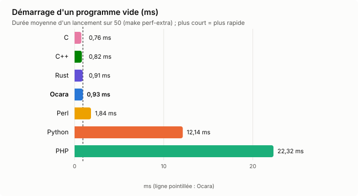
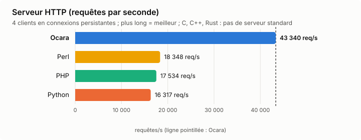
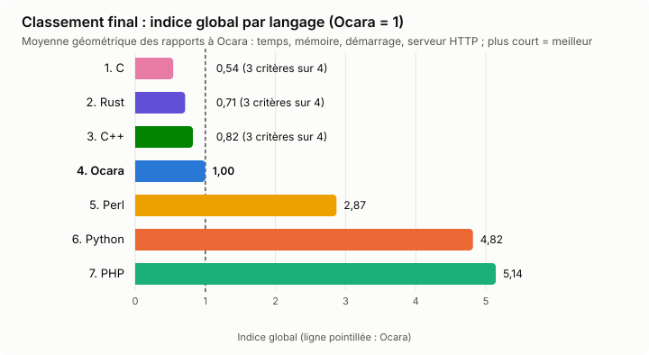

# Benchmarking : mémoire et temps

Ce guide décrit comment mesurer la consommation mémoire (détection de
fuites) et le temps d'exécution d'un programme Ocara, avec les pièges qui
faussent une mesure et les résultats de référence actuels.

Prérequis : un compilateur à jour (`make build`), et `/usr/bin/time`
(paquet `time`) pour le pic mémoire.

## Détecter une fuite : le bilan `--leak-check` (le plus simple)

`ocara programme.oc --leak-check -o programme` compte chaque allocation et
chaque libération de valeur (chaînes, tableaux, maps, objets par classe,
closures…), avec la fonction qui a alloué chaque valeur. À la sortie du
programme, ce qui n'a pas été libéré est listé par classe ou par genre, puis
par fonction d'allocation (fichier et ligne de sa déclaration) — aucun
marqueur, aucune boucle à écrire :

```
── fuites : 2 valeur(s) non libérée(s) à la sortie ──
       1 × Job                          (allouées 1, libérées 0)
                1 alloué(s) dans startWorker — worker.oc:8
       1 × variable capturée            (allouées 1, libérées 0)
                1 alloué(s) dans startWorker — worker.oc:8
```

- `OCARA_LEAK_OUT=fuites.tsv ./programme` écrit le bilan dans un fichier :
  `K<TAB>genre<TAB>restants<TAB>alloués<TAB>libérés`, suivi pour ce genre de
  lignes `S<TAB>genre<TAB>nombre<TAB>fonction<TAB>fichier<TAB>ligne`.
- Une valeur allouée dans une closure est attribuée à la fonction qui
  l'appelle.
- Juste avant le bilan, une passe du collecteur de cycles libère les valeurs
  qui y attendaient : ce qui reste est réellement perdu.
- Le programme doit se terminer normalement (un serveur arrêté par un signal
  ne produit pas de bilan) : pour un serveur, voir « le plateau » plus bas.
- Sans `--leak-check`, le coût est nul (un test de booléen par allocation).

Dans VS Code : encart Benchmark → « Détecter les fuites » ; chaque genre se
déplie en fonctions d'allocation, un clic ouvre la fonction.

## Détecter une fuite : le pic mémoire à deux tailles

Le principe : exécuter le même programme pour N et 10 × N itérations, et
comparer le pic mémoire (`%M` de `/usr/bin/time`, en Ko). Un programme sans
fuite a le même pic aux deux tailles ; une fuite fait grandir le pic
proportionnellement au nombre d'itérations.

Le programme lit son nombre d'itérations dans un marqueur `__N__` :

<!-- doc-check: skip -->
```ocara
import ocara.IO
import ocara.Convert

function work(i:int): int {
    var s:string = "item " + Convert::intToStr(i)
    return s.len()
}

function main(): int {
    var total:int = 0
    var i:int = 0
    while i smaller __N__ {
        total = total + work(i)
        i = i + 1
    }
    IO::writeln(Convert::intToStr(total))
    return 0
}
```

Script de mesure (`measure.sh programme.oc`) :

```bash
#!/bin/bash
# Compile et mesure le pic mémoire pour N = 20 000 puis 200 000.
OC=./target/release/ocara
for n in 20000 200000; do
  sed "s/__N__/$n/" "$1" > "/tmp/bench_$n.oc"
  "$OC" "/tmp/bench_$n.oc" -o "/tmp/bench_$n" > /dev/null || exit 1
  /usr/bin/time -f "$n: %M Ko" "/tmp/bench_$n" > /dev/null
done
```

Lecture du résultat :

```
20000: 2084 Ko
200000: 1960 Ko     → stable : pas de fuite
```

```
20000: 4048 Ko
200000: 17780 Ko    → fuite : (17780 - 4048) × 1024 / 180 000 ≈ 78 octets par itération
```

L'ordre de grandeur des octets perdus par itération oriente la recherche :
8 octets pour un entier dans un tableau, environ 40 pour une petite chaîne,
48 ou plus pour un objet.

## Mesurer un serveur HTTP : le plateau

Un serveur ne termine pas : on suit sa mémoire résidente (`VmRSS`) pendant
qu'on lui envoie des séries de requêtes. Sans fuite, elle se stabilise après
les premières séries (plateau) ; avec une fuite, elle grandit à chaque série.

```bash
#!/bin/bash
# Lance le serveur, envoie 3 séries de 4 000 requêtes, affiche VmRSS après chacune.
./serveur > /tmp/serveur.log 2>&1 &
PID=$!
sleep 2
for serie in 1 2 3; do
  for i in $(seq 1 2000); do
    curl -s -o /dev/null http://127.0.0.1:8081/voitures/1
    curl -s -o /dev/null "http://127.0.0.1:8081/recherche?q=a"
  done
  echo "$((serie * 4000)) requêtes : $(grep VmRSS /proc/$PID/status | awk '{print $2}') Ko"
done
kill $PID
```

La première série monte toujours (caches, pages SQLite, allocateur) : seule
l'évolution entre les séries suivantes compte. Pour un serveur qui n'a pas
d'interface sans fenêtre, compiler une variante de son point d'entrée qui
démarre seulement le serveur (voir
`examples/advanced/mini_project_hexa/probe_main.oc`).

## Mesurer le temps

```bash
/usr/bin/time -f "%e s, %M Ko" ./programme
```

Pour comparer deux versions du compilateur sur le même programme :

```bash
git stash          # version de référence
make build
./target/release/ocara bench.oc -o bench_avant
git stash pop      # version modifiée
make build
./target/release/ocara bench.oc -o bench_apres
/usr/bin/time -f "avant : %e s" ./bench_avant
/usr/bin/time -f "après : %e s" ./bench_apres
```

Exécuter chaque mesure plusieurs fois et garder le minimum et la médiane
(voir « Préparer une mesure fiable ») : le temps d'un programme court varie
d'une exécution à l'autre. Un micro-benchmark doit
faire au moins quelques millions d'opérations pour dépasser le bruit.

## Profiler par fonction : `--profile`

`ocara programme.oc --profile -o programme` encadre chaque fonction et
méthode d'une mesure de temps (`src/ir/profile.rs`, `runtime/src/profile.rs`).
À la sortie du programme, une ligne par fonction, temps propre décroissant :

```
── profil (appels, total ns, propre ns, fonction) ──
57313	6641619	6641619	Calc.fib
1	6675235	23231	main
1	10385	8854	work
```

- **total** : temps passé dans la fonction et ses appelées (appel externe
  seulement pour une fonction récursive) ; **propre** : sans les appelées.
- `OCARA_PROFILE_OUT=fichier.tsv ./programme` écrit le rapport dans un
  fichier au lieu de stderr.
- La mesure coûte quelques dizaines de nanosecondes par appel : comparer
  les fonctions entre elles, pas le temps absolu à un build sans `--profile`.
- Un programme interrompu (serveur arrêté par un signal) n'écrit pas de
  rapport.

## Préparer une mesure fiable

Noter l'environnement avant chaque série : sur une machine chargée, seules
les comparaisons relatives restent valables.

```bash
nproc; uptime                      # charge moyenne > nproc/2 : comparer en relatif
cat /proc/sys/kernel/perf_event_paranoid /proc/sys/kernel/yama/ptrace_scope
```

Répéter et garder le **minimum** (meilleur estimateur sur une machine
chargée) et la **médiane** (un grand écart avec le min signale du bruit) :

```bash
#!/bin/bash
# run.sh RUNS label binaire… → min, médiane, pic mémoire
R=$1; shift; L=$1; shift; : > /tmp/times_$L.txt
for i in $(seq 1 $R); do
  /usr/bin/time -f "%e %M" -o /tmp/t1.txt timeout 120 "$@" > /dev/null 2> /tmp/err_$L.txt
  cat /tmp/t1.txt >> /tmp/times_$L.txt
done
sort -n /tmp/times_$L.txt | awk -v l="$L" '{t[NR]=$1; if($2>m)m=$2}
  END{printf "%-28s min %6.3f  med %6.3f  rss %d KB\n", l, t[1], t[int((NR+1)/2)], m}'
```

## Détecter une complexité super-linéaire : le test par doublement

Même principe que le pic mémoire à deux tailles, appliqué au temps : on
double N plusieurs fois et on regarde le rapport des temps.

```bash
for N in 10000 20000 40000 80000; do
  sed "s/__N__/$N/g" bench.oc > b_$N.oc && ./target/release/ocara b_$N.oc -o b_$N > /dev/null
  ./run.sh 3 b_$N ./b_$N
done
```

Rapport d'environ 2 quand N double : linéaire ; environ 4 : quadratique ; un
saut plus fort : effet de cache. Avec trois tailles éloignées, la pente
log-log `log(t2/t1) / log(N2/N1)` donne l'exposant directement (1 : linéaire,
2 : quadratique).

Le même test s'applique au **compilateur** : générer des programmes de
taille croissante (nombre d'instructions dans une fonction, de fonctions, de
classes, longueur d'une chaîne `elseif`, profondeur d'une expression) et
mesurer `--check` (lexer, parseur, sema), `--no-link -o x.o` (avec
abaissement et Cranelift) et la compilation complète. `strace -f -tt -e
trace=execve,exit_group ./target/release/ocara …` sépare le temps de
compilation de celui de l'éditeur de liens.

## Comparer à une référence Python et C

Écrire le même algorithme en Python (`time.perf_counter()`) et en C
(`cc -O2`, avec `__attribute__((noinline))` sur la fonction appelée, sinon la
boucle est éliminée). Ordre de grandeur attendu pour du code compilé : entre
C et 10 fois C. Plus lent que Python signale un problème (voir
[roadmap.d/perf-runtime-complexite.md](roadmap.d/perf-runtime-complexite.md)).

## Profiler le runtime avec `perf`

`--profile` mesure les fonctions Ocara ; le temps passé dans le runtime
(retain/release, collecte de cycles, allocations) y est compté dans
l'appelant. `perf` le montre par symbole :

```bash
sudo sysctl kernel.perf_event_paranoid=1      # temporaire ; sinon « No supported events found »
perf stat -r 5 -e task-clock,cycles,instructions,cache-misses,context-switches ./prog > /dev/null
perf record -g --call-graph dwarf -o perf.data ./prog > /dev/null
perf report -i perf.data --stdio --no-children --percent-limit 2 | head -60
```

Compiler **sans** `--release` : ce mode retire les symboles (perf et gdb
n'affichent plus que des adresses) et ne change pas la vitesse.

## Profiler sans `perf` : échantillonnage par `SIGPROF`

Sans les droits pour `perf`, une bibliothèque chargée par `LD_PRELOAD` relève
l'instruction en cours à chaque `SIGPROF` (temps CPU du processus) et les
écrit à la sortie ; `addr2line` les rattache aux fonctions. Un échantillon ne
coûte presque rien : quelques exécutions suffisent pour des milliers
d'échantillons.

```c
// sigprof.c — gcc -O2 -shared -fPIC -o sigprof.so sigprof.c
// LD_PRELOAD=./sigprof.so SIGPROF_OUT=pcs.txt ./prog
#define _GNU_SOURCE
#include <signal.h>
#include <stdio.h>
#include <stdlib.h>
#include <sys/time.h>
#include <ucontext.h>

#define MAX_SAMPLES (1 << 20)
static unsigned long pcs[MAX_SAMPLES];
static volatile int count;

static void on_tick(int sig, siginfo_t *info, void *context) {
    if (count < MAX_SAMPLES) pcs[count++] = ((ucontext_t *)context)->uc_mcontext.gregs[REG_RIP];
}

__attribute__((destructor)) static void dump(void) {
    struct itimerval off = {0};
    setitimer(ITIMER_PROF, &off, NULL);
    FILE *out = fopen(getenv("SIGPROF_OUT"), "w");
    for (int i = 0; out && i < count; i++) fprintf(out, "%lx\n", pcs[i]);
    if (out) fclose(out);
}

__attribute__((constructor)) static void start(void) {
    struct sigaction action = {0};
    action.sa_sigaction = on_tick;
    action.sa_flags = SA_SIGINFO | SA_RESTART;
    sigaction(SIGPROF, &action, NULL);
    struct itimerval every = {{0, 1000}, {0, 1000}};
    setitimer(ITIMER_PROF, &every, NULL);
}
```

```bash
for i in 1 2 3 4 5; do LD_PRELOAD=./sigprof.so SIGPROF_OUT=pcs$i.txt ./prog 1000000 > /dev/null; done
cat pcs*.txt > pcs.txt
addr2line -f -C -e ./prog < pcs.txt | awk 'NR % 2' | sort | uniq -c | sort -rn | head -25
```

- Le noyau arrondit l'intervalle à son tic : environ 100 échantillons par
  seconde de calcul.
- Un exécutable Ocara n'est pas relogeable : ses adresses se lisent telles
  quelles. Celles d'une bibliothèque partagée (libc) sortent en `??`.
- Seule la fonction feuille est relevée. Les adresses les plus fréquentes
  d'une fonction (`sort pcs.txt | uniq -c | sort -rn`), lues dans
  `objdump -d --no-show-raw-insn -C prog`, désignent l'instruction qui attend :
  souvent le chargement qui précède, en défaut de cache.
- Pour les piles complètes, voir l'échantillonnage avec gdb ci-dessous.

## Profiler sans `perf` : échantillonnage avec gdb

Sans les droits pour `perf` ni `gdb -p` (`ptrace_scope=1`), on lance le
programme **sous** gdb et on l'interrompt de l'extérieur par `SIGUSR2` ; à
chaque arrêt, le script relève la pile de chaque thread.

```python
# pmp.py — gdb -batch -nx -x pmp.py --args ./prog
import gdb, collections
for c in ["set debuginfod enabled off", "set pagination off", "set confirm off",
          "handle SIGUSR2 stop print nopass", "handle SIGPIPE nostop noprint pass"]:
    gdb.execute(c)
leaf, incl, stacks = collections.Counter(), collections.Counter(), collections.Counter()
def sample():
    for t in gdb.selected_inferior().threads():
        t.switch(); f = gdb.newest_frame(); names = []
        while f is not None and len(names) < 16:
            names.append(f.name() or hex(f.pc())); f = f.older()
        if names:
            leaf[names[0]] += 1; stacks[" <- ".join(names[:5])] += 1
            for n in set(names): incl[n] += 1
gdb.execute("run", to_string=True)
while gdb.selected_inferior().pid != 0:
    sample()
    try: gdb.execute("continue", to_string=True)
    except gdb.error: break
tot = sum(leaf.values()) or 1
for title, c in (("propre", leaf), ("inclusif", incl), ("piles", stacks)):
    print("==", title, "==")
    for k, v in c.most_common(15): print("%5.1f%% %s" % (100 * v / tot, k))
```

```bash
#!/bin/bash
# pmp.sh <échantillons> <intervalle_s> <binaire>
B=$3; NAME=$(basename "$B" | cut -c1-15)
gdb -batch -nx -x pmp.py --args "$B" 2> /dev/null | sed -n "/^==/,\$p" &
G=$!
for i in $(seq 1 $1); do sleep $2; kill -0 $G 2> /dev/null || break; pkill -USR2 -x "$NAME"; done
pkill -KILL -x "$NAME"; wait $G
```

- `handle … noprint` implique `nostop` : il faut écrire `stop print`.
- Chaque échantillon coûte environ 30 ms : viser 50 à 200 échantillons sur un
  programme de 2 à 5 s (`./pmp.sh 150 0.01 ./prog`).
- Les signaux arrivent au retour des appels système : la part des fonctions
  qui en font (`sigprocmask`) est gonflée. Confirmer avec `strace -c`.
- Pour le compilateur lui-même, même méthode sur `target/debug/ocara` (avec
  symboles) : `( sleep N; pkill -INT -x ocara ) & gdb -batch -ex run -ex "bt 40"
  --args target/debug/ocara prog.oc --no-link -o y.o`.

## Compter les appels au runtime : points d'arrêt gdb

Compte exact des retain/release et des collectes de cycles (environ 1 000
fois plus lent : prendre un N petit, par exemple 10⁵) :

```
# count.gdb — gdb -batch -nx -x count.gdb ./prog
set debuginfod enabled off
set breakpoint pending off
break ocara_runtime::rc::collect_cycles
ignore 1 100000000
break __rc_retain
ignore 2 1000000000
break __rc_release
ignore 3 1000000000
run > /dev/null
info breakpoints
```

Lire « breakpoint already hit N times ». Une fonction inlinée (par exemple
`possible_root`) n'a pas de point d'arrêt.

## Appels système dans une boucle : `strace -c`

```bash
strace -c -o sys.txt ./prog > /dev/null; head -15 sys.txt     # mono-thread
strace -f -c -o sys.txt ./prog > /dev/null                     # threads, async
```

Un nombre d'appels proportionnel à N signale un appel système par
itération : `futex` (attente de verrou, réveil d'un thread du pool de
tâches `async`). Une exception n'en fait plus aucun (`_setjmp`, sans
sauvegarde du masque de signaux).

## `/usr/bin/time -v` : champs utiles

`/usr/bin/time -v ./prog > /dev/null 2> tv.txt` :

- « Maximum resident set size » : le pic mémoire (`%M`) ;
- « Voluntary context switches » : attentes, `join` ;
- « Involuntary context switches » : machine chargée ;
- « Minor page faults » : environ une par page allouée (allocations
  massives) ;
- « User » / « System time » : un temps système élevé signale des appels
  système dans la boucle.

## Lire le comptage de références généré : `--dump`

```bash
./target/release/ocara prog.oc --dump -o prog > dump.txt
grep -n "^func " dump.txt
sed -n '/^func Classe_methode/,/^func /p' dump.txt | grep -c "__rc_retain\|__rc_release"
```

Utile pour vérifier ce qu'un appel de méthode, un gabarit ou une boucle
coûte en retain/release, et si une valeur est boxée (`__box_int_for_mixed`).

## Fuites invisibles au bilan `--leak-check`

Le bilan compte les valeurs Ocara. Une instance Rust créée par un builtin
(`Box::into_raw`) sans destruction correspondante n'y apparaît pas : seul le
pic mémoire à deux tailles la révèle (10⁵ contre 10⁶ instances). Liste des
candidats :

```bash
grep -n "Box::into_raw\|Box::from_raw" runtime/src/*.rs
```

Pour un bilan sur tous les exemples : compiler chaque `examples/**/*.oc` qui
a un `main` avec `--leak-check`, l'exécuter sous `timeout 30` avec une entrée
standard préparée, puis classer avec `grep -q "fuites : aucune"`. Copier
seulement les sources (les dossiers `.ocaraunit_cache` pèsent des dizaines de
Go).

## Serveur HTTP sous charge concurrente

Le plateau ci-dessus utilise `curl` en série. Pour une charge concurrente,
un script Python avec un `ThreadPoolExecutor` et une
`http.client.HTTPConnection` par thread (keep-alive) envoie N requêtes avec un
parallélisme P, compte les codes HTTP et les exceptions, et relève `VmRSS` et
`Threads` dans `/proc/$(pgrep -x serveur)/status` avant et après. Répéter 3 à
6 séries pour vérifier le plateau. Référence : environ 5 000 à 6 600
requêtes/s avec 8 workers.

Cas limites à couvrir : clients lents (corps incomplet avec un
`Content-Length` annoncé, en-têtes incomplets) en nombre égal aux workers ;
sockets brutes (pipelining, HTTP/1.0, chunked, octets non UTF-8) ;
fichiers statiques binaires (`curl -s $B/big.bin -o got.bin; cmp got.bin
www/big.bin`).

## Dans VS Code : encart « Benchmark »

La barre latérale Ocara (icône du logo) a un encart « Benchmark » pour le
script affiché :

- **Mesurer temps et mémoire** : build Release, `ocara.benchmark.runs`
  exécutions (5 par défaut), temps moyen/min/max et pic mémoire ;
- **Détecter une fuite (`__N__`)** : la méthode ci-dessus, avec les deux
  valeurs de `ocara.benchmark.leakSizes` ; verdict stable ou fuite probable
  (croissance du pic de plus de 1 Mo et de 10 %) ;
- **Profiler par fonction** : build `--profile`, tableau par fonction ;
- **Historique** : mesures conservées par script, avec l'écart à la mesure
  précédente du même genre (▲ plus lent/plus gros, ▼ mieux).

Chaque exécution est limitée à `ocara.benchmark.timeout` secondes (30 par
défaut). Le pic mémoire demande `/usr/bin/time`.

Pistes d'évolution de l'encart (courbe de complexité, compteurs du runtime,
flamegraph, `strace -c`, comparaison A/B) :
[roadmap.d/tooling-vscode-benchmark-profilage.md](roadmap.d/tooling-vscode-benchmark-profilage.md).

## Pièges

- **Le détecteur de cycles agit par lots** : un objet qui a été partagé puis
  libéré peut rester en attente jusqu'à ce que 10 000 candidats se soient
  accumulés. Mesurer sur au moins 20 000 itérations ; en dessous, la mémoire
  semble monter alors qu'elle sera rendue au lot suivant.
- **Threads** : la collecte des cycles a lieu aussi pendant que d'autres
  threads tournent (collecte concurrente) ; quand ils produisent des cycles
  plus vite qu'elle ne les rend, ils l'attendent brièvement — un programme
  multi-thread qui crée beaucoup de cycles peut donc paraître plus lent
  qu'en mono-thread, à mémoire bornée.
- **SQLite** garde un cache de pages par connexion : ouvrir une base dans
  la boucle mesure aussi ce cache. Comparer à taille égale de données.
- **Compiler en dehors de la mesure** : `/usr/bin/time` doit porter sur le
  binaire, jamais sur `ocara`.
- **Sortie** : rediriger la sortie standard (`> /dev/null`) pour ne pas
  mesurer l'affichage du terminal.
- **`--release` ne rend pas plus rapide** : il retire seulement les symboles
  (Cranelift sans niveau d'optimisation). Pour profiler, garder un build par
  défaut.
- **Le temps propre de `--profile`** inclut le runtime (retain/release,
  collectes) et environ 95 ns de mesure par appel instrumenté.
- **Collectes de cycles mal attribuées** : en mono-thread, une collecte est
  déclenchée par le `release` qui fait déborder le tampon ; son coût apparaît
  dans une fonction utilisateur arbitraire (un constructeur, un accesseur).
- **Threads et `async`** : mesurer à petite taille (2 000 et 10 000) et sans
  `ulimit -v`, qui fait échouer la création des threads (abort, rc 134).
  Plusieurs dizaines de Ko par itération signalent un thread jamais joint.
- **Code de retour** : relever le code de sortie à chaque taille (124 :
  délai, 134 : abort, 139 : SIGSEGV) ; un plantage qui n'apparaît qu'à grande
  taille est souvent une valeur brute prise pour un pointeur (seuil 65 536,
  `PTR_THRESHOLD`).

## Mesures de référence

Programmes de mesure du chantier sur le comptage de références
([roadmap.d/memoire-refcount.md](roadmap.d/memoire-refcount.md)), pic mémoire
à 20 000 puis 200 000 itérations :

| Scénario | 20 000 | 200 000 |
|---|---|---|
| Concaténations de chaînes dans une fonction | 2,1 Mo | 2,0 Mo |
| Objets, conteneur partagé par deux porteurs, `match` | 3,0 Mo | 3,0 Mo |
| Closures avec captures, appels indirects | 2,8 Mo | 3,1 Mo |
| Exceptions levées et rattrapées | 2,7 Mo | 2,9 Mo |
| `raise` traversant trois fonctions avec locales | 2,6 Mo | 2,7 Mo |
| Générateurs (`for`, `break`, `return`, `fromMessage`) | 2,0 Mo | 2,0 Mo |
| Ressources `scoped` fermées par un `raise` | 3,3 Mo | 3,3 Mo |
| Cycles créés dans un thread pendant un `join` | 3,8 Mo | 3,9 Mo |

Serveur `examples/advanced/mini_project_hexa` : plateau à environ 9,5 Mo sur
16 000 requêtes (`/voitures/1` et `/recherche`).

Coût d'un appel de fonction manipulant des valeurs comptées (retenue,
libération, enregistrement pour le déroulement des exceptions) : environ
20 ns (5 millions d'appels en 0,11 s).

Audit du 2026-10-19, mis à jour le 2026-10-21 (machine de 12 cœurs chargée ;
minimum de 3 à 5 exécutions). Règle : **aucune mesure ne doit être plus lente
qu'un langage interprété (Python, PHP, Perl)**. `make perf`
(`ci/perf_compare.sh`, programmes dans `ci/perf/`, liste dans
`ci/perf/benches.txt`) la vérifie : chaque mesure compile le programme Ocara
et l'exécute avec le même algorithme en Python, PHP, Perl, C, C++ et Rust
(`<nom>.py`, `.php`, `.pl`, `.c`, `.cpp`, `.rs` ; minimum de 5 exécutions),
et échoue si Ocara est plus lent qu'un langage interprété ; C, C++ et Rust
sont affichés en référence. Un programme qui ne peut pas s'exécuter
(bibliothèque absente du langage : JSON ou YAML en C, regex ou SQLite en Rust
sans crate ; module non installé : PyYAML, DBD::SQLite) est sauté (« — »).
`make perf-extra` (`ci/perf_extra.sh`) compare à part, dans les mêmes
langages, le démarrage, la mémoire résidente maximale de chaque mesure et le
débit d'un serveur HTTP. Hors de `make regression`, les temps dépendant de la
charge de la machine.
Pistes restantes :
[roadmap.d/perf-runtime-complexite.md](roadmap.d/perf-runtime-complexite.md).

Un programme Python de comparaison écrit `text += …` dans une fonction :
au niveau du module, la concaténation n'est plus faite en place et devient
quadratique (la mesure ne finit pas). Un nom de fichier ne doit pas masquer
un module (`yaml.py`, `http.py`).



Moyenne globale de chaque langage : moyenne géométrique, sur les mesures de
`make perf` qu'il exécute (nombre entre parenthèses), du rapport entre son
temps et celui d'Ocara — sous 1, plus rapide qu'Ocara. Une moyenne
géométrique de rapports ne laisse pas une mesure longue écraser les autres ;
un temps affiché `0,00` compte pour 0,005 s (moitié de la résolution).

Mesures du 2026-10-22, une colonne par langage (`make perf`, `make perf-extra` ;
minimum de 5 exécutions, au centième de seconde). En **gras**, le temps
d'Ocara quand il est meilleur que Python, PHP et Perl, et chaque langage
meilleur qu'Ocara ; <u>**souligné en gras**</u>, un résultat égal à celui
d'Ocara ; « — » : mesure sautée pour ce langage (voir `ci/README.md`).
Tableaux, graphiques et classement sont régénérés par `ci/perf_report.py`
depuis les sorties de `make perf` et `make perf-extra`.

| Mesure (temps en s, `make perf`) | Ocara | Python | PHP | Perl | C | C++ | Rust |
|---|---|---|---|---|---|---|---|
| `map<string,int>`, 10⁶ insertions + lectures (`map`) | **0,10** | 0,51 | 0,12 | 0,70 | — | 0,54 | 0,38 |
| `s = s + "x"`, 10⁶ (`concat`) | **0,00** | 0,03 | 0,02 | 0,02 | <u>**0,00**</u> | <u>**0,00**</u> | <u>**0,00**</u> |
| Exception levée et rattrapée, 10⁶ (`exc`) | **0,06** | 0,15 | 0,15 | 0,11 | — | 0,62 | 1,15 |
| Graphe de 10⁶ objets liés, parcouru 5 fois (`cycles`) | **0,35** | 0,82 | 1,04 | 0,78 | **0,03** | **0,06** | **0,05** |
| Gabarit à trois parties, 2·10⁶ (`tpl`) | **0,08** | 0,30 | 0,10 | 0,11 | 0,09 | 0,09 | <u>**0,08**</u> |
| 10⁷ appels de méthode qui en appelle une autre (`meth`) | **0,01** | 0,79 | 0,24 | 1,39 | **0,00** | **0,00** | **0,00** |
| Tableau : 2·10⁶ `push` + 2·10⁷ lectures (`arr`) | **0,03** | 1,22 | 0,16 | 0,42 | **0,01** | **0,02** | **0,01** |
| `async` + `resolve`, 5·10⁴ (`asy`) | **0,10** | 0,22 | 0,20 | — | — | 0,92 | — |
| Boucle flottante + `fib(30)` (`loop`) | **0,07** | 1,13 | 0,19 | 0,93 | **0,01** | **0,01** | **0,02** |
| `String::split` (6 morceaux), 10⁶ (`split`) | 0,12 | 0,15 | **0,09** | 0,20 | **0,08** | 0,24 | 0,14 |
| `String::replace` + `upper`, 10⁶ (`replace`) | 0,08 | 0,12 | <u>**0,08**</u> | 0,19 | **0,05** | **0,06** | **0,06** |
| Parcours `for k has v in m`, 2·10⁶ paires (`mapiter`) | **0,01** | 0,10 | 0,03 | 0,19 | — | **0,00** | **0,00** |
| `Array::join` + `intToStr`, 10⁶ (`join`) | 0,09 | 0,18 | **0,07** | 0,10 | **0,07** | **0,03** | **0,01** |
| 10⁶ objets créés + appel de méthode (`objs`) | **0,07** | 0,62 | 0,17 | 0,65 | **0,03** | **0,03** | **0,03** |
| Comparaisons de chaînes, 2·10⁷ (`strcmp`) | **0,20** | 0,66 | 0,21 | 0,52 | **0,02** | **0,00** | **0,00** |
| `Array::sort`, 10⁶ entiers (`sort`) | **0,04** | 0,18 | 0,21 | 0,20 | 0,05 | 0,05 | **0,02** |
| `JSON::encode` + `decode`, 2·10⁵ (`jsonb`) | 0,21 | 0,57 | **0,13** | 6,01 | — | — | — |
| 2·10⁷ appels via une interface (`iface`) | **0,03** | 0,88 | 0,26 | 1,24 | **0,00** | **0,02** | **0,02** |
| Closure qui modifie une capture, 10⁷ (`clos`) | **0,12** | 0,42 | 0,19 | 0,52 | — | **0,02** | **0,00** |
| `map<int,int>`, 10⁶ insertions + lectures (`mapint`) | **0,02** | 0,17 | 0,03 | 0,66 | — | 0,04 | 0,09 |
| Générateur `emit` + `for`, 10⁷ valeurs (`gen`) | **0,01** | 0,53 | 0,20 | 0,62 | — | **0,00** | **0,00** |
| Arithmétique `mixed` / `int\|float`, 10⁷ (`mixed`) | 0,07 | 0,70 | <u>**0,07**</u> | 0,32 | **0,00** | **0,01** | **0,00** |
| Objets après un `Thread` (comptes atomiques), 10⁶ (`mt`) | **0,09** | 0,51 | — | 0,31 | **0,03** | **0,05** | **0,05** |
| Exception de classe levée et rattrapée, 10⁶ (`excls`) | 0,17 | 0,30 | **0,16** | 0,53 | — | 0,61 | 1,54 |
| `Regex::test` + `replace`, 3·10⁵ (`regex`) | 0,06 | 0,34 | <u>**0,06**</u> | 0,11 | <u>**0,06**</u> | 0,13 | — |
| Fichier de 2·10⁶ lignes écrit, relu, découpé (`file`) | 0,22 | 0,32 | **0,21** | 0,25 | **0,12** | **0,17** | **0,18** |
| `strToInt` + `strToFloat`, 2·10⁶ (`conv`) | **0,14** | 0,58 | 0,15 | 0,32 | 0,24 | 0,16 | **0,12** |
| `Array::contains`/`indexOf`/`slice`/`reverse`/`pop`, 2·10⁵ (`arrops`) | **0,08** | 1,18 | 0,22 | 5,13 | **0,06** | **0,04** | **0,04** |
| `Array::sort`, 10⁶ chaînes (`sortstr`) | **0,30** | 0,35 | 0,38 | 0,65 | **0,21** | **0,21** | **0,25** |
| `SQLite` : 2·10⁵ insertions + 2·10⁴ `queryOne` (`sqlite`) | 0,13 | 0,24 | **0,11** | — | **0,06** | **0,07** | — |
| `YAML::decode`, 5·10⁴ entrées (`yamldec`) | **0,10** | 1,06 | — | — | — | — | — |
| `DateTime::format`, 10⁶ (`date`) | **0,07** | 0,65 | 0,19 | 2,89 | <u>**0,07**</u> | 0,31 | — |
| `Mutex` `lock`/`unlock` sans contention, 10⁷ (`mutex`) | **0,12** | 0,99 | — | 0,62 | **0,03** | **0,03** | **0,10** |



Moyenne géométrique de la mémoire résidente maximale, en Mo, sur les 18
mesures que les sept langages exécutent tous : une moyenne sur les mesures
propres à chaque langage favoriserait celui qui saute les plus gourmandes
(C n'a ni `map` ni `mapint`).

| Mesure (mémoire résidente maximale en Mio, `make perf-extra`) | Ocara | Python | PHP | Perl | C | C++ | Rust |
|---|---|---|---|---|---|---|---|
| `map` | **62,0** | 115,1 | 100,6 | 197,1 | — | 75,4 | 128,8 |
| `concat` | **4,2** | 9,9 | 33,1 | 6,8 | **2,6** | 5,2 | **2,9** |
| `exc` | **3,2** | 9,0 | 32,0 | 5,9 | — | 3,7 | **2,1** |
| `cycles` | **86,6** | 124,0 | 141,8 | 260,3 | **39,4** | **64,3** | **55,2** |
| `tpl` | **3,1** | 9,1 | 32,0 | 6,0 | **1,5** | 3,6 | **1,8** |
| `meth` | **3,3** | 8,9 | 32,0 | 6,0 | **1,5** | 3,6 | **2,1** |
| `arr` | **18,5** | 85,6 | 63,4 | 69,9 | **16,7** | 19,3 | **17,3** |
| `asy` | **5,2** | 19,5 | 32,1 | — | — | **3,9** | — |
| `loop` | **3,1** | 9,2 | 31,7 | 6,2 | **1,6** | 3,6 | **2,1** |
| `split` | **3,2** | 9,0 | 31,9 | 5,8 | **1,5** | 3,6 | **2,1** |
| `replace` | **4,5** | 9,1 | 32,0 | 5,8 | **1,5** | **3,5** | **2,1** |
| `mapiter` | **3,5** | 9,4 | 32,0 | 6,2 | — | 3,7 | **2,1** |
| `join` | **3,1** | 9,0 | 31,9 | 5,8 | **1,6** | 3,6 | **1,9** |
| `objs` | **71,8** | 154,8 | 133,1 | 312,9 | **39,5** | **41,3** | **40,1** |
| `strcmp` | **3,1** | 9,0 | 31,9 | 6,1 | **1,6** | 3,4 | **1,9** |
| `sort` | **26,1** | 60,4 | 87,4 | 97,7 | **16,3** | **10,8** | **17,2** |
| `jsonb` | **7,1** | 10,2 | 31,8 | 7,9 | — | — | — |
| `iface` | **3,2** | 9,1 | 32,1 | 5,9 | **1,5** | 3,5 | **2,0** |
| `clos` | **3,2** | 9,1 | 31,7 | 6,0 | — | 3,5 | **2,0** |
| `mapint` | **26,4** | 111,8 | 48,7 | 129,6 | — | 44,6 | 53,0 |
| `gen` | **3,3** | 9,1 | 31,9 | 5,9 | — | 3,6 | **2,1** |
| `mixed` | **4,4** | 9,0 | 32,0 | 5,9 | **1,5** | **3,5** | **2,1** |
| `mt` | **72,3** | 124,8 | — | 214,4 | **39,7** | **49,3** | **40,1** |
| `excls` | **5,5** | 9,1 | 32,0 | 5,7 | — | **3,8** | **2,1** |
| `regex` | **5,3** | 10,1 | 32,0 | 6,0 | **1,7** | **3,8** | — |
| `file` | **162,8** | 208,6 | 205,4 | 225,7 | **27,4** | **118,8** | **159,9** |
| `conv` | **3,3** | 9,0 | 31,9 | 6,2 | **1,5** | 3,8 | **2,1** |
| `arrops` | **3,4** | 9,2 | 32,0 | 6,2 | **1,5** | 3,5 | **2,0** |
| `sortstr` | **56,6** | 75,8 | 117,0 | 189,5 | **47,0** | **33,7** | 66,6 |
| `sqlite` | **9,6** | 15,1 | 36,8 | — | **7,1** | **8,4** | — |
| `yamldec` | **77,2** | 157,1 | — | — | — | — | — |
| `date` | **3,1** | 9,1 | 31,7 | 7,3 | **1,5** | 3,7 | — |
| `mutex` | **3,1** | 9,7 | — | 6,9 | **1,5** | 3,5 | **1,8** |





| Mesure (`make perf-extra`) | Ocara | Python | PHP | Perl | C | C++ | Rust |
|---|---|---|---|---|---|---|---|
| Démarrage d'un programme vide (ms) | **0,92** | 11,56 | 19,22 | 1,89 | **0,73** | **0,76** | 0,99 |
| Serveur HTTP, 4 clients en connexions persistantes (requêtes/s) | **34001** | 15058 | 19438 | 17788 | — | — | — |

Mesures ponctuelles (hors `make perf`) :

| Mesure | Ocara | Référence |
|---|---|---|
| Boucle d'entiers, 2·10⁸ itérations | 0,58 s (`while`), 0,43 s (`for … until`) | C `-O2` 0,15 s ; Python ≈ 11,6 s |
| Boucle de flottants, 10⁸ itérations | 0,25 s | C `-O2` 0,10 s |
| Appel de fonction libre / accesseur / méthode qui appelle | 1,4 ns / 0,5 ns / ≈ 1 ns si l'appelée ne peut pas libérer `self`, ≈ 15 ns sinon | C 0,5 ns ; méthode Python 37 ns |
| `use P(i)` (objet int + string) | ≈ 80 ns | Python 123 ns |
| Serveur HTTP, 8 workers | 5 000–6 600 requêtes/s | — |

## Classement final



Indice global de chaque langage : moyenne géométrique de ses quatre moyennes
ci-dessus, chacune ramenée à Ocara et orientée « plus petit = meilleur » —
temps relatif, mémoire résidente maximale divisée par celle d'Ocara,
démarrage divisé par celui d'Ocara, débit HTTP d'Ocara divisé par le sien.
C, C++ et Rust n'ont pas de serveur HTTP dans leur bibliothèque standard :
leur indice porte sur trois critères.

| Rang | Langage | Indice global | Temps relatif | Mémoire (Mo) | Démarrage (ms) | Serveur HTTP (req/s) |
|---|---|---|---|---|---|---|
| 1 | C | 0,55 | 0,45 | 4,2 | 0,73 | — |
| 2 | Rust | 0,75 | 0,59 | 5,7 | 0,99 | — |
| 3 | C++ | 0,83 | 0,76 | 7,9 | 0,76 | — |
| 4 | **Ocara** | **1,00** | **1,00** | **8,7** | **0,92** | **34 001** |
| 5 | Perl | 2,71 | 6,54 | 18,4 | 1,89 | 17 788 |
| 6 | Python | 4,41 | 5,57 | 20,8 | 11,56 | 15 058 |
| 7 | PHP | 4,52 | 2,02 | 49,3 | 19,22 | 19 438 |
